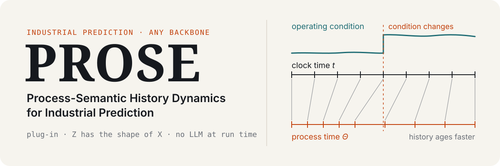

<picture>
  <source media="(prefers-color-scheme: dark)" srcset="./assets/readme/hero-dark.svg">
  
</picture>

<p align="center">
  
  
  
  
  <br>
  <b>English</b> · <a href="./README.zh-CN.md">简体中文</a>
</p>

**PROSE** (Process-Semantic History Dynamics) is a plug-in history representation for industrial
prediction. An LLM describes each variable once, offline; at run time these frozen semantics let history
age by process progress rather than elapsed time. The output has the same shape as the input, so any
backbone reads it unchanged.

## Quick start

```bash
uv sync --extra train
uv run python scripts/train.py --dataset thickener_dewatering --backbone gru --method prose \
  --seed 2024 --set training.max_epochs=2
```

Processed data (`windows.npz`) and frozen semantics for all three datasets are included, so training
needs no API key. Add `--device cpu` if no GPU is available.

| Dataset | Task |
| --- | --- |
| `ladle_preheating` | 60-step history → next 5 temperatures (field data, scaled to [0, 1]) |
| `thickener_dewatering` | 30-min history → underflow concentration (simulated) |
| `indpensim` | 120-step history → offline penicillin concentration |

## Usage

- **Options:** `--backbone` is one of `gru lstm transformer informer mamba itransformer patchtst moderntcn`;
  `--method` is `base` or `prose`. Override any config field with `--set section.field=value`.
- **Batch runs:** `uv run python scripts/run_study.py [configs/studies/smoke.yaml]` runs every
  combination on all visible GPUs (default: `configs/run.yaml`).
  `scripts/collect_results.py` gathers the metrics into a CSV.
- **Rebuilding semantics:** copy `configs/env/api.env` to `api.local.env` and fill in the endpoints.
  Then run `uv sync --extra llm`, `scripts/build_semantic_cards.py --dataset all --call-api` and
  `scripts/build_semantic_artifact.py --dataset all --source llm`. The LLM reads only
  `task_spec.json` and `PROCESS.md`.

## License

MIT. This is a research artifact and is not intended for production control.
